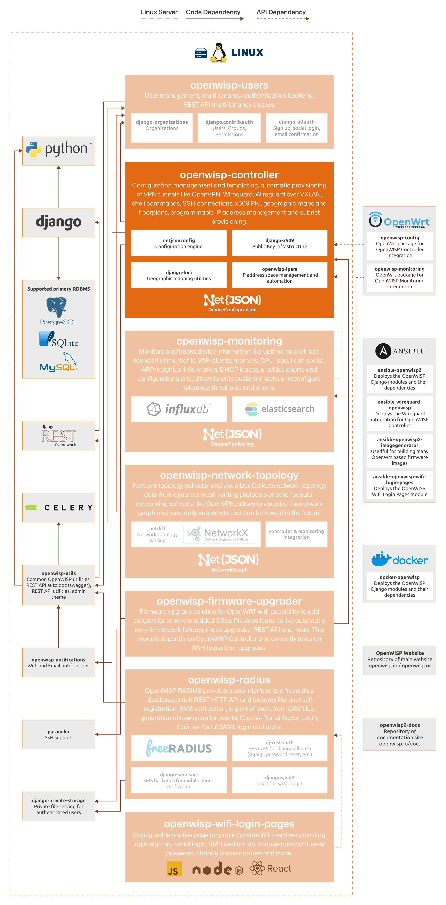

Developer Installation Instructions
===================================

.. include:: ../partials/developer-docs.rst

The following diagram illustrates the role of the Controller module within
the OpenWISP architecture.

    **OpenWISP Architecture: highlighted controller module**

.. important::

    For an enhanced viewing experience, open the image above in a new
    browser tab.

    Refer to :doc:`/general/architecture` for more information.

.. contents:: **Table of Contents**:
    :depth: 2
    :local:

Dependencies
------------

- Python >= 3.11
- OpenSSL

Installing for Development
--------------------------

Install the system dependencies:

.. code-block:: shell

    sudo apt update
    sudo apt install -y sqlite3 libsqlite3-dev openssl libssl-dev
    sudo apt install -y gdal-bin libproj-dev libgeos-dev libspatialite-dev libsqlite3-mod-spatialite
    # For running E2E Selenium tests (Firefox is the default browser)
    sudo apt install firefox chromium

Fork the `openwisp-controller repository
<https://github.com/openwisp/openwisp-controller>`_ on GitHub, then clone
your fork. Replace ``YOUR_GITHUB_USERNAME`` with your GitHub username:

.. code-block:: shell

    git clone git@github.com:YOUR_GITHUB_USERNAME/openwisp-controller.git

Navigate into the cloned repository:

.. code-block:: shell

    cd openwisp-controller/

Launch Redis:

.. code-block:: shell

    docker compose up -d redis

Setup and activate a virtual-environment (we'll be using `virtualenv
<https://pypi.org/project/virtualenv/>`_):

.. code-block:: shell

    python -m virtualenv env
    source env/bin/activate

Make sure that your base python packages are up to date before moving to
the next step:

.. code-block:: shell

    pip install -U pip wheel setuptools

Install development dependencies:

.. code-block:: shell

    pip install -e .
    pip install -r requirements-test.txt
    sudo npm install -g prettier

Install WebDriver for Chromium for your browser version from
https://chromedriver.chromium.org/home and Extract ``chromedriver`` to one
of directories from your ``$PATH`` (example: ``~/.local/bin/``).

Create database:

.. code-block:: shell

    cd tests/
    ./manage.py migrate
    ./manage.py createsuperuser

Launch celery worker (for background jobs and periodic jobs respectively):

.. code-block:: shell

    celery -A openwisp2 worker -l info
    celery -A openwisp2 beat -l info

Launch development server:

.. code-block:: shell

    ./manage.py runserver 0.0.0.0:8000

You can access the admin interface at ``http://127.0.0.1:8000/admin/``.

Run tests with (make sure you have the :ref:`selenium dependencies
<selenium_dependencies>` installed locally first):

.. code-block:: shell

    ./runtests

Browser tests run serially under ASGI and are tagged ``selenium_tests``.
Keep Redis running: tests which broadcast updates from the test process to
the ASGI server need a channel layer shared between processes. To run only
the browser tests, without ``--parallel``:

.. code-block:: shell

    ./tests/manage.py test openwisp_controller --tag=selenium_tests --noinput

Controller browser tests inherit ``ControllerLiveServerTestCase`` from
``openwisp_controller.tests.utils`` to restore migration-created data
consistently between tests. Apply server-side configuration before
``super().setUpClass()``: method-level patches do not affect the separate
ASGI server process.

Run quality assurance tests with:

.. code-block:: shell

    ./run-qa-checks

Alternative Sources
-------------------

Pypi
~~~~

To install the latest Pypi:

.. code-block:: shell

    pip install openwisp-controller

Github
~~~~~~

To install the latest development version tarball via HTTPs:

.. code-block:: shell

    pip install https://github.com/openwisp/openwisp-controller/tarball/master

Alternatively you can install the latest development version from Git:

.. code-block:: shell

    pip install -e git+https://github.com/openwisp/openwisp-controller#egg=openwisp_controller

.. _controller_dev_docker:

Install and Run on Docker
-------------------------

.. warning::

    This Docker image is for development purposes only.

    For the official OpenWISP Docker images, see: :doc:`docker-openwisp
    </docker/index>`.

Build from the Dockerfile:

.. code-block:: shell

    docker compose build

Run the docker container:

.. code-block:: shell

    docker compose up

Troubleshooting Steps for Common Installation Issues
----------------------------------------------------

You may encounter some issues while installing GeoDjango.

Unable to Load SpatiaLite library Extension?
~~~~~~~~~~~~~~~~~~~~~~~~~~~~~~~~~~~~~~~~~~~~

If you are incurring in the following exception:

.. code-block:: text

    django.core.exceptions.ImproperlyConfigured: Unable to load the SpatiaLite library extension

You need to specify ``SPATIALITE_LIBRARY_PATH`` in your ``settings.py`` as
explained in `django documentation regarding how to install and configure
spatialte
<https://docs.djangoproject.com/en/5.2/ref/contrib/gis/install/spatialite/>`_.

Having Issues with Other Geospatial Libraries?
~~~~~~~~~~~~~~~~~~~~~~~~~~~~~~~~~~~~~~~~~~~~~~

Please refer `troubleshooting issues related to geospatial libraries
<https://docs.djangoproject.com/en/5.2/ref/contrib/gis/install/#library-environment-settings/>`_.

.. important::

    If you want to add OpenWISP Controller to an existing Django project,
    then you can refer to the `test project in the openwisp-controller
    repository
    <https://github.com/openwisp/openwisp-controller/tree/master/tests/openwisp2>`_.
